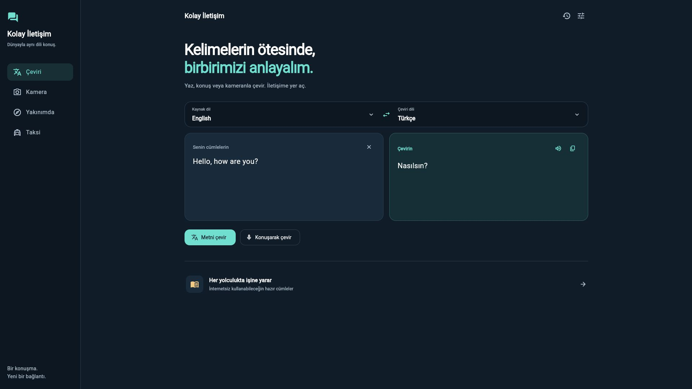
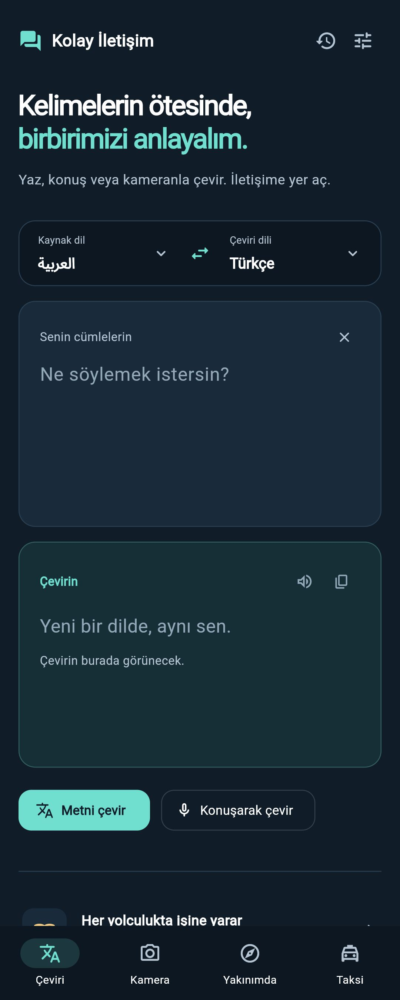

# Kolay İletişim · SpeakBridge

**Yaz, konuş veya kameranla çevir. Dünyayla aynı dili konuş.**

Kolay İletişim; seyahat ederken, yeni bir şehirde veya günlük hayatta farklı dillerde iletişim kurmayı kolaylaştıran bir Flutter uygulamasıdır. Metin ve sesli çeviriyi; hazır cümleler, kamera ile metin okuma, yakın yerleri keşfetme ve taksi durağı arama özellikleriyle bir araya getirir.

[Canlı web demosu](https://halidenehsen.netlify.app/previews/speakbridge/) · [Geliştiricinin web sitesi](https://halidenehsen.netlify.app/)

## Arayüz

### Masaüstü · 1920 × 1080

[](docs/images/desktop-hd.jpg)

Yan menü ve iki sütunlu çalışma alanı, metni ve çeviri sonucunu birlikte gösterir. Yukarıdaki örnekte çalışan çeviri akışından alınan bir sonuç bulunur.

<details>
<summary><strong>Mobil görünüm · 1080 × 2700 — görmek için aç</strong></summary>

<p align="center">
  <a href="docs/images/mobile-hd.jpg"></a>
</p>

Telefonda dikey yerleşim ve alt gezinme kullanılır. Uzun ekran görüntüsü giriş alanını, çeviri sonucunu ve işlem düğmelerini birlikte gösterir.

</details>

Görseller uygulamadan yeniden, yüksek çözünürlükte alınmıştır. Tam boy görüntülemek için görsele tıkla.

## Neler yapabilirsin?

- **Metin çevirisi:** Kaynak ve hedef dili seç, metnini yaz, sonucu kopyala veya sesli dinle.
- **Sesli iletişim:** Mikrofon üzerinden konuşmayı metne dönüştür ve çevir.
- **Kamera ile metin okuma:** Fotoğraftaki metni OCR servisiyle tanı ve çeviri akışında kullan.
- **Hazır cümleler:** Yolculuk sırasında kullanılabilecek yerel cümle arşivine ulaş.
- **Geçmiş ve ayarlar:** Önceki çevirilere dön; varsayılan dilleri, ses hızını ve tema tercihini düzenle.
- **Yakın yerler ve taksi:** Konumunu kullanmayı seçtiğinde çevrendeki yerleri ve taksi duraklarını bul.

Desteklenen diller: Türkçe, Arapça, İngilizce, Almanca, Fransızca, İspanyolca, Rusça, Çince ve Japonca.

## İzinler ve bağlantı

Uygulama açıldığında konum izni istenmez. Harita ve taksi ekranları arka planda başlatılmaz; konum isteği yalnızca **Konumumu kullan** düğmesine basıldığında çalışır. Harita ekranından ayrılınca konum takibi kapatılır. Mikrofon servisi konuşarak çeviri başlatıldığında, kamera ise kamera ekranına geçildiğinde kullanılır.

Metin çevirisi, OCR, harita verisi ve yakın yer aramaları internet ve üçüncü taraf servislerin kullanılabilirliğine bağlıdır. Hazır cümle arşivi yereldir. Web'de kamera, mikrofon ve konum için HTTPS veya localhost gerekir; tarayıcı ve işletim sistemi desteği değişebilir.

## Teknolojiler

Flutter / Dart, Material 3, Provider, SharedPreferences, HTTP, speech_to_text, flutter_tts, camera, image_picker, flutter_map, Geolocator ve OpenStreetMap tabanlı harita servisleri.

Çeviri katmanında MyMemory ve Lingva; görsel metin tanımada OCR.space kullanılır. Servis kotaları ve erişim koşulları sağlayıcıya bağlıdır.

## Yerelde çalıştır

Flutter SDK ve Dart **3.12.2 veya üzeri** gerekir. Proje Flutter 3.44.8 ile web için derlenmiştir.

```bash
git clone https://github.com/Halit1elnehsen/kolay-iletisim-.git
cd kolay-iletisim-
flutter pub get
flutter run -d chrome
```

OCR özelliğini kendi servis anahtarınla çalıştırmak için:

```bash
flutter run -d chrome --dart-define=OCR_API_KEY=YOUR_OCR_SPACE_KEY
```

Web istemcisine gömülen anahtarlar tarayıcıdan görülebilir; özel servis anahtarlarını sunucu tarafında saklamak gerekir.

## Derleme ve doğrulama

```bash
flutter test
flutter build web --release
```

Bir alt dizine yayınlarken:

```bash
flutter build web --release --base-href /previews/speakbridge/
```

Güncel arayüz için beş widget testi; ilk açılışı, konum ekranlarının kullanıcı eylemini beklemesini, mobil/masaüstü yerleşimini ve metin girişini kapsar. Web release derlemesi ve tarayıcıda İngilizce–Türkçe çeviri akışı doğrulanmıştır. Donanım izinleri ve platforma özgü özellikler ayrıca gerçek cihazda test edilmelidir.

## Kod yapısı

```text
lib/
  screens/       Çeviri, kamera, harita, taksi, geçmiş ve ayarlar
  providers/     Arayüz durum yönetimi
  services/      Çeviri, ses, OCR, konum ve harita servisleri
  models/        Veri modelleri
  theme/         Ortak renkler ve tema
  widgets/       Yeniden kullanılabilir bileşenler
assets/phrases/  Yerel hazır cümleler
docs/images/     README ekran görüntüleri
test/            Widget testleri
```

Geliştirici: [Halid Elnehsen](https://github.com/Halit1elnehsen)
